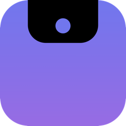
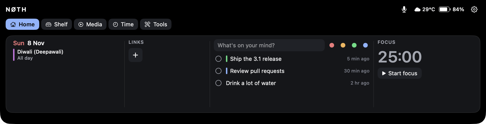
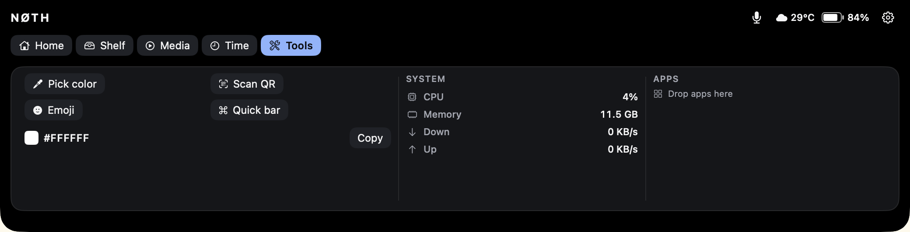
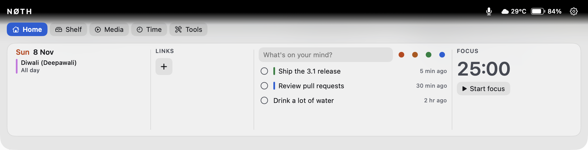

<div align="center">



# NØTH

**Your MacBook notch, as a command center.**

Live activities, files, music, calendar, timers and everyday tools — one hover
away, right where the notch already is.

[Download](https://github.com/manugowda19/noth/releases/latest) ·
[Build from source](#build-from-source) ·
[Privacy](#privacy) ·
[Contributing](CONTRIBUTING.md)




</div>

## Why NØTH

- **Native and light.** Swift, AppKit and SwiftUI. About 2% CPU and 45 MB of
  memory while idle. No Electron, no account, no telemetry.
- **Private by default.** Everything runs on your Mac. Features that touch the
  network or need a permission are off until you turn them on, and each one
  says what it uses.
- **Open source.** MIT licensed. Read it, build it, change it.

## Features

### The Island

The pill that sits on the notch. It stays black and blends with the hardware,
then comes alive when something is happening:

- **Now Playing** from any app, browsers included, with album art, real audio
  bars and synced lyrics.
- **Timers** — Pomodoro (sessions, long breaks, skip) and a stopwatch.
- **Activity** — download progress, camera and microphone in use, a meeting
  about to start, Caps Lock, drives and displays connecting, battery, break
  reminders.
- **Hover** for a quick strip of controls; **drop a file** on the notch to keep
  it on the Shelf.

### The Command Center

Click the notch, press **⌥⌘J**, or use the menu-bar icon. Five tabs, one size,
nothing repeated:

| Tab | What's there |
|---|---|
| **Home** | Now Playing, today's calendar, pinned links, quick notes with color tags, focus timer |
| **Shelf** | Parked files (AirDrop, Copy Path, Quick Look), clipboard history, snippets, recent items |
| **Media** | Live synced lyrics, sound output switcher, focus sounds (white, pink, brown noise) |
| **Time** | Stopwatch, reminders, today's timeline, screen time |
| **Tools** | Color picker, QR scanner, emoji, Quick bar (calculator + search), system stats, app launcher, Bluetooth batteries |



### Make it yours

- **Glass panel** — frosted, see-through, in dark or light.
- **Everything is a switch** in Settings (⌘,), grouped by Media, Time, Shelf,
  Alerts and System. A first-run screen picks a good starting set.
- **Keyboard** — ⌥⌘J opens, ⌘1–5 switches tabs, Esc closes. Optional global
  shortcuts for notes, Pomodoro, screenshots, mic mute and window snapping.
- **Extras** — volume and brightness HUD in the notch, lock-screen card
  (experimental), keep awake, keyboard clean mode.



## Install

1. Download **Noth-3.1.0.dmg** from the
   [latest release](https://github.com/manugowda19/noth/releases/latest).
2. Open it and drag **Noth** to **Applications**.
3. The app isn't notarized yet (that needs a paid Apple Developer account), so
   the first time, **right-click Noth › Open › Open**. After that it opens
   normally.

NØTH runs in the menu bar and the notch — there's no Dock icon. Requires
macOS 14 Sonoma or later. On a Mac or display without a notch it shows as a
small pill at the top of the screen (less tested — reports welcome).

## Privacy

NØTH has no servers and collects nothing. It only goes online for:

| What | Where | When |
|---|---|---|
| Weather | [Open-Meteo](https://open-meteo.com) | Only if Weather is on |
| Synced lyrics | [lrclib.net](https://lrclib.net) (song title + artist) | Only if Synced lyrics is on |
| Site icons | The pinned site itself | Only if Site icons is on |
| Update check | GitHub | Only when you click Check for Updates… |
| Web search | Your browser | Only when you search from the Quick bar |

Clipboard history is off by default, kept in memory only, and skips anything a
password manager marks as concealed. Links from QR codes and pins never open
on their own. macOS permissions (Calendars, Reminders, Camera, Accessibility…)
are asked only when you turn on a feature that needs them.

## Build from source

You need macOS 14+ and Xcode or the Command Line Tools (Swift 5.9+).
`cmake` is optional and enables Now Playing for every app.

```bash
git clone https://github.com/manugowda19/noth.git
cd noth
./build.sh debug        # fast native build
open Noth.app
```

| Command | What it does |
|---|---|
| `./build.sh` | Release build, universal (Apple silicon + Intel) |
| `Scripts/run_tests.sh` | Runs the model tests |
| `Scripts/make_dmg.sh` | Builds `Noth-<version>.dmg` |

More in [BUILD.md](BUILD.md); how it fits together in
[ARCHITECTURE.md](ARCHITECTURE.md).

## Known limitations

- Not notarized yet — see [Install](#install).
- The lock-screen card and brightness control use private macOS APIs. They're
  opt-in, loaded at runtime, and switch themselves off if a future macOS
  removes them.
- Updates: Check for Updates… tells you about a new version and opens the
  release page; it doesn't install it for you yet.

## Contributing

Bug reports, ideas and pull requests are welcome — see
[CONTRIBUTING.md](CONTRIBUTING.md).

## Credits

- [mediaremote-adapter](https://github.com/ungive/mediaremote-adapter)
  (BSD-3-Clause) by Jonas van den Berg, for Now Playing on macOS 15.4+.
- Lyrics from [LRCLIB](https://lrclib.net); weather from
  [Open-Meteo](https://open-meteo.com).

## License

[MIT](LICENSE) © 2026 Manu Gowda
